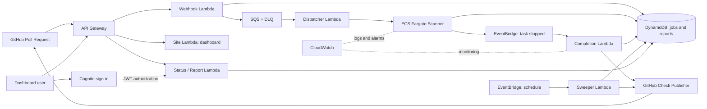

# MergeGuard — Cloud Security Checks for GitHub Pull Requests test2

**CS6620 Fundamentals of Cloud Computing | Team:** Mingyuan Zhuang, Snahil Singh Dasawat, Zihao Wang.

## Project scope 

MergeGuard integrates the **course-provided JavaScript SAST scanner** into a GitHub pull-request workflow. The course permits using **one or both** of its tools, so the API pentester is intentionally out of scope. It detects hardcoded secrets, injection patterns, XSS and other issues before PR merge. Developers see a GitHub Check and a dashboard report.

## Architecture 

 The diagram groups services by function to keep the end-to-end flow readable. The scanner runs in private VPC subnets and uses a NAT gateway for outbound access.



**Infrastructure:** Terraform provisions the VPC (two public and two private subnets across availability zones), a single NAT gateway, security groups, API Gateway, Lambda, SQS, DynamoDB, ECS Fargate, Cognito, EventBridge and CloudWatch. GitHub Actions publishes the scanner image to Docker Hub; ECS pulls the pinned image digest. The public dashboard is served by API Gateway and Site Lambda, not by CloudFront or S3.

### Service inventory

| Layer | AWS service / component | Purpose |
|---|---|---|
| Entry and UI | API Gateway HTTP API + Site Lambda | Serve dashboard assets and route API requests |
| Authentication | Amazon Cognito + API Gateway JWT authorizer | Sign in the demo user and authorize status/report requests |
| Ingestion | Webhook Lambda | Validate GitHub signature and deduplicate PR events |
| Buffering | Amazon SQS + DLQ | Decouple webhook traffic from scanner startup; retain failed messages |
| Orchestration | Dispatcher Lambda + ECS Fargate | Start one containerized scanner task per accepted job |
| Networking | VPC, public/private subnets, routes, IGW, NAT, security group | Keep scanner tasks private while allowing outbound connectivity |
| State and results | Amazon DynamoDB | Store job state, scan correlation, and JSON findings/report |
| Completion | EventBridge ECS STOPPED rule + Completion Lambda | Mark completed/failed jobs using task exit and report presence |
| Recovery | EventBridge schedule + Sweeper Lambda | Detect stale jobs and retry missed check publication |
| Feedback | Notify path + Publisher Lambda + GitHub Checks API | Publish scan outcomes to the pull request |
| Monitoring | CloudWatch Logs, metric filter and alarm | Investigate errors, stopped tasks and operational failures |
| Image delivery | GitHub Actions + Docker Hub | Build and publish an immutable scanner container image |

## Team responsibilities and repository layout

The responsibilities below follow the project's **progress-slide ownership** and describe the current implementation and demonstration scope. They do not independently establish who authored each line of code.

| Team member | Primary responsibility | Files and services | Demo / verification ownership |
|---|---|---|---|
| **Snahil Singh Dasawat** | AWS infrastructure, networking and API orchestration | `infra/main.tf`, `infra/terraform.tfvars.example`, `services/webhook.js`, `services/dispatcher.js`, `services/status.js`, `services/common.js`; VPC, API Gateway, SQS, DynamoDB, Cognito integration | Terraform plan/apply; webhook HMAC; duplicate event handling; SQS-to-Fargate dispatch; authenticated scan lookup |
| **Zihao Wang** | Static analysis engine, container delivery and observability | `scanner/scanner.js`, `scanner/runner.js`, `scanner/Dockerfile`, `.github/workflows/scanner.yml`, `tests/test-local.mjs`; ECS task definition and CloudWatch integration | SAST rule tests; Docker Hub image build/digest; scanner execution and report generation; logs and metrics; false-positive evaluation |
| **Mingyuan Zhuang** | Dashboard, scan completion, GitHub checks and recovery | `dashboard/`, `services/site.js`, `services/site-assets/`, `services/completion.js`, `services/publisher.js`, `services/sweeper.js`, `services/notify.js`; EventBridge completion and schedule | Dashboard and Cognito flow; terminal status updates; report access; GitHub Check publication; timeout and recovery tests |

**Shared team tasks:** end-to-end testing, security review, performance evaluation, documentation, presentation, and AWS resource cleanup. Refer to `docs/CONTRIBUTIONS.md` for the original slide-based assignment; update that document separately if actual contributions differ.

## Deployment guide (AWS Learner Lab / Windows PowerShell)

The steps below target the **S3-free, no-CloudFront classroom variant**. JSON reports are stored in DynamoDB, and the public HTTPS dashboard is served by API Gateway and the `site` Lambda. Other archived variants may use S3; check the `infra/main.tf` in the version you actually deploy. Commands assume you are in the repository root unless a `cd` is shown.

### 1. Prerequisites

- AWS Academy Learner Lab credentials with permissions for the resources in `infra/main.tf` (including ECS Fargate, VPC/NAT, Lambda, API Gateway, DynamoDB, SQS, EventBridge, Cognito, Secrets Manager and CloudWatch).
- AWS CLI v2, Terraform >= 1.5, Node.js >= 22 and npm, Docker Desktop, and Git.
- A Docker Hub account and a GitHub repository containing **public** JavaScript code to scan.
- An existing AWS lab IAM role whose ARN can be passed to ECS/Lambda; this variant does not create new IAM roles.

The default region is `us-east-1`. Start the Learner Lab session and place its **temporary** AWS credentials in `$HOME\.aws\credentials`. Verify that the token has not expired:

```powershell
aws sts get-caller-identity
aws configure get region
```

Learner Lab service-control policies may block individual actions. An explicit SCP deny cannot be fixed by adding a Terraform argument or a user-level IAM policy; request an instructor-approved alternative.

### 2. Install dependencies and run local tests

```powershell
node --version
npm.cmd --version
node --test tests/test-local.mjs
cd services
npm.cmd install --omit=dev
cd ..
```

The Lambda archive built by Terraform packages the `services` directory and its installed dependencies. On Windows PowerShell, use `npm.cmd` if `npm.ps1` is blocked by execution policy. Do not commit `node_modules`.

### 3. Build and publish the scanner image

**Option A — GitHub Actions (recommended):** In the GitHub repository, open **Settings → Secrets and variables → Actions** and create `DOCKERHUB_USERNAME` and `DOCKERHUB_TOKEN` (a Docker Hub access token with write permission). Run the **Scanner image CI** workflow defined in `.github/workflows/scanner.yml` using a trigger supported by that workflow (inspect its `on:` section). Confirm that `docker/login-action` and `docker/build-push-action` succeed. Record the immutable `sha256:...` digest from the build output.

**Option B — Local Docker:**

```powershell
docker build --platform linux/amd64 -t YOUR_DOCKERHUB_USERNAME/mergeguard:v1 ./scanner
docker login
docker push YOUR_DOCKERHUB_USERNAME/mergeguard:v1
docker buildx imagetools inspect YOUR_DOCKERHUB_USERNAME/mergeguard:v1
```

Use the resulting image reference in Terraform, for example `docker.io/YOUR_DOCKERHUB_USERNAME/mergeguard@sha256:ACTUAL_DIGEST`. Never use a made-up digest. If you modify `scanner/runner.js`, rebuild and publish the image before updating Terraform.

### 4. Create GitHub and AWS secrets

Create a GitHub fine-grained personal access token for the test repository with **Checks: Read and write** permission. Generate a separate strong random webhook secret. Store both in AWS Secrets Manager as a JSON secret with the keys `github_token` and `webhook_secret` (do not place token values in source control).

For example, after securely preparing a local JSON file containing those two fields:

```powershell
aws secretsmanager create-secret `
  --name mergeguard/github `
  --secret-string file://mergeguard-secret.json `
  --region us-east-1
aws secretsmanager describe-secret `
  --secret-id mergeguard/github `
  --query ARN --output text --region us-east-1
```

Keep `mergeguard-secret.json` outside the repository and delete the local copy securely after use. Save the returned secret ARN for the next step. If the secret already exists, update it instead of creating a duplicate.

### 5. Configure Terraform

```powershell
cd infra
Copy-Item terraform.tfvars.example terraform.tfvars
```

Edit `infra/terraform.tfvars` with values appropriate to your AWS account:

```hcl
region                 = "us-east-1"
project                = "mergeguard"
scanner_image          = "docker.io/YOUR_DOCKERHUB_USERNAME/mergeguard@sha256:ACTUAL_DIGEST"
lab_role_arn           = "arn:aws:iam::YOUR_ACCOUNT_ID:role/YOUR_LAB_ROLE"
github_secret_arn      = "arn:aws:secretsmanager:us-east-1:YOUR_ACCOUNT_ID:secret:mergeguard/github-EXAMPLE"
allowed_repo           = "YOUR_GITHUB_USERNAME/YOUR_PUBLIC_REPOSITORY"
demo_user_sub          = "REPLACE_AFTER_COGNITO_USER_CREATION"
cognito_domain_prefix  = "mergeguard-unique-demo-prefix"
dashboard_callback_url = "http://localhost:8000/"
```

The `demo_user_sub` and callback URL are finalized after the first apply. The Cognito domain prefix must be available. The `lab_role_arn` must reference an existing authorized role; check the role name in your lab rather than assuming `LabRole` is present.

### 6. Deploy AWS infrastructure

```powershell
terraform init
terraform fmt
terraform validate
terraform plan
terraform apply
terraform output
```

Review the plan before entering `yes`. Terraform creates the network, NAT gateway, ECS task definition, DynamoDB job table, SQS queue and DLQ, Lambda functions, API Gateway, Cognito, EventBridge rules and CloudWatch resources defined by this variant. **NAT gateways incur charges while provisioned.**

If an earlier deployment partially failed, inspect `terraform state list` and `terraform plan` before applying again. Do not delete state files to hide existing AWS resources. If you see `ExpiredToken`, refresh the Learner Lab credentials. If you see S3 Object Lock or CloudFront access-denied errors, check that you are actually using the S3-free/no-CloudFront Terraform version.

**Scanner filesystem fix:** The scanner needs a writable temporary directory for cloning. If CloudWatch reports `EROFS: read-only file system, mkdtemp '/tmp/mergeguard-XXXXXX'`, review the ECS container setting `readonlyRootFilesystem`. The demonstrated lab workaround was `false`; for production, design a restricted writable scratch mount instead. **The archived S3-free Terraform example still contains `readonlyRootFilesystem=true`: change it to `false` before applying if you are using the same scanner runner and have not implemented a writable `/tmp` mount.** Apply the updated task definition and trigger a **new** scan.

### 7. Create a Cognito user and update the callback

From the `infra` directory:

```powershell
$pool = terraform output -raw cognito_user_pool_id
$email = "YOUR_EMAIL@example.com"
aws cognito-idp admin-create-user `
  --user-pool-id $pool `
  --username $email `
  --user-attributes "Name=email,Value=$email" "Name=email_verified,Value=true" `
  --region us-east-1
aws cognito-idp admin-get-user `
  --user-pool-id $pool --username $email --region us-east-1
terraform output -raw dashboard_url
```

Copy the Cognito user's `sub` attribute into `demo_user_sub`, and set `dashboard_callback_url` to the exact HTTPS dashboard URL returned by Terraform, including its trailing `/`. Then run:

```powershell
terraform plan
terraform apply
```

Sign in through the dashboard and complete the first-login password change if prompted. The demo uses a single explicitly authorized Cognito user, not general multi-user GitHub authorization.

### 8. Configure the GitHub pull-request webhook

In the **public test repository**, go to **Settings → Webhooks → Add webhook** and configure:

| Field | Value |
|---|---|
| Payload URL | `<api_url>/webhook`, using `terraform output -raw api_url` |
| Content type | `application/json` |
| Secret | The same `webhook_secret` stored in Secrets Manager |
| SSL verification | Enabled |
| Events | **Pull requests** |
| Active | Enabled |

Open a pull request or push another commit to an existing PR. Supported actions include `opened`, `synchronize`, and `reopened`. Check **Recent Deliveries** for the webhook response and copy the returned 64-character `scan_id`.

### 9. Verify the scan and dashboard

```powershell
$dashboard = terraform output -raw dashboard_url
Start-Process $dashboard
aws ecs list-tasks --cluster mergeguard-cluster --desired-status STOPPED --region us-east-1
aws logs tail /mergeguard/scanner --since 1h --region us-east-1
aws dynamodb scan --table-name mergeguard-jobs --region us-east-1
```

Enter the `scan_id` in the dashboard and select **Check status**. Expected states include `QUEUED`, `STARTING`, `RUNNING` and a terminal state such as `COMPLETED` or `FAILED`. On `COMPLETED`, use **Open JSON report** and verify the report contains findings and a scan identifier. Check the pull request's **Checks** tab to confirm whether the GitHub Check Publisher also posted a result; a completed scan alone does not prove check publication.

For the S3-free variant, the report is held in the DynamoDB job item, subject to DynamoDB's 400 KB item limit (the implementation rejects reports over 300 KB). The demonstrated scan produced 84 findings, including 12 HIGH findings. Several matches come from scanning the scanner's own regex rules and test fixtures. Findings are heuristic: self-scanning rules and test fixtures can produce false positives, so `COMPLETED` means the job finished, **not** that all findings are confirmed vulnerabilities.

### 10. Troubleshooting

| Symptom | Check or fix |
|---|---|
| `npm` not recognized | Install Node.js LTS and reopen PowerShell |
| `npm.ps1` execution blocked | Use `npm.cmd install --omit=dev` |
| Docker login: `Username and password required` | Add the exact GitHub Actions secrets `DOCKERHUB_USERNAME` and `DOCKERHUB_TOKEN` |
| Terraform `ExpiredToken` | Restart Learner Lab and refresh AWS CLI credentials |
| Terraform `AccessDenied` / explicit SCP deny | Confirm lab permissions and variant; contact instructor for restricted services |
| Scanner `EROFS` under `/tmp` | Provide a writable scratch directory or use the documented lab workaround |
| Dashboard stuck at `RUNNING` | Inspect stopped ECS tasks, scanner logs, Completion Lambda and EventBridge |
| Missing GitHub Check | Inspect Publisher Lambda logs, token permissions and check-publication state |
| No JSON report | Check the scan's terminal state, DynamoDB report attribute and report size |

### 11. Clean up AWS resources

From `infra`, review the destruction plan and remove the resources when the classroom demo is complete:

```powershell
terraform plan -destroy
terraform destroy
```

Terraform does not automatically delete manually created Secrets Manager secrets. Remove those separately when no longer needed. Confirm that billable NAT gateways and other resources are gone. Never commit `terraform.tfvars`, Terraform state, AWS credentials, GitHub tokens, or local secret JSON files.

For additional scenarios and evaluation guidance, see [docs/TEST_PLAN.md](docs/TEST_PLAN.md). Some older documentation describes an S3-backed variant; the steps above describe the DynamoDB-report variant.

## Security and limitations

- Webhook HMAC SHA-256 verified on raw bytes; conditional DynamoDB insert deduplicates repository+SHA+scanner version.
- GitHub Check token stays in Secrets Manager. Demo scanner supports **public repos only**; a private-repo GitHub App installation token workflow is not implemented.
- Dashboard uses Cognito JWT plus **one explicit allowed user and one repository**. Not a multi-user GitHub authorization system.
- Learner Lab existing role may be overprivileged and require `iam:PassRole` permissions. Use proper separate task/execution/Lambda roles in production.
- Scanner runs untrusted code **as data** for regex scanning; git clone is still an untrusted network operation. Do not grant repo write credentials to scanner.
- A task STOPPED event can race the task ARN update; GitHub Check POST retries may create duplicates. These are documented residual limitations.
- One NAT is not AZ-resilient; no real-world availability/SLA claim is made.
- Never commit `terraform.tfvars`, credentials, PATs, local state or `node_modules`.

## No-CloudFront public dashboard

The public HTTPS Dashboard is served directly by API Gateway and the `site` Lambda. No CloudFront or public S3 website is used. See `docs/NO_CLOUDFRONT.md`.
