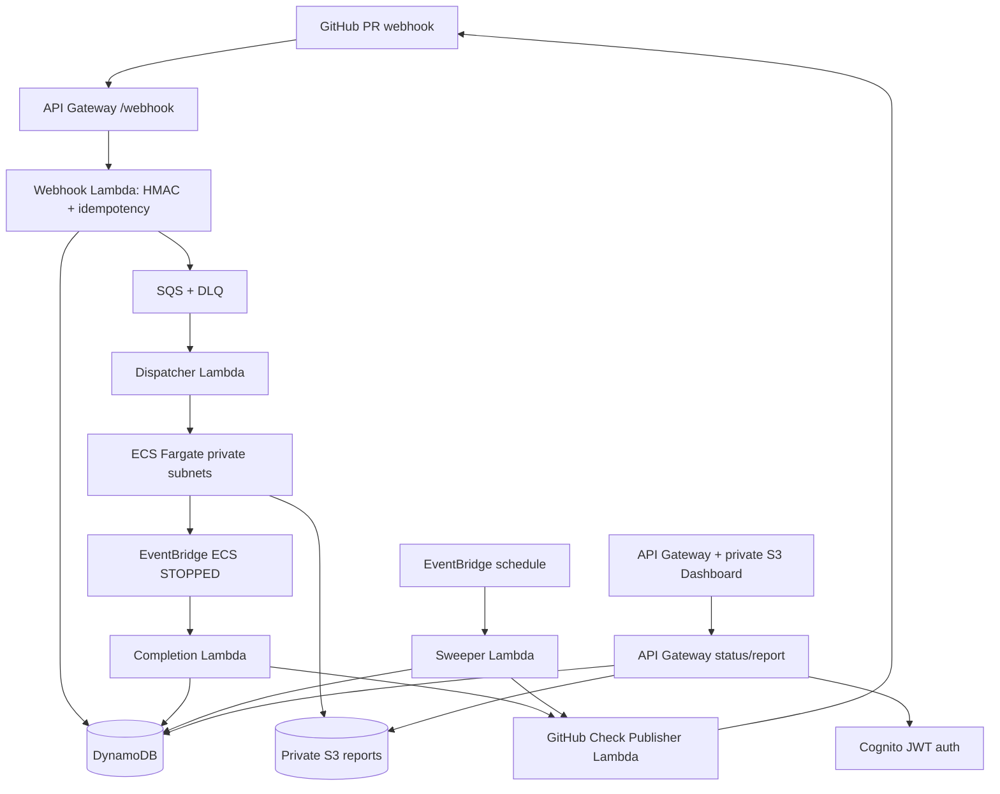

# MergeGuard — Cloud Security Checks for GitHub Pull Requests test2

**CS6620 Fundamentals of Cloud Computing | Team:** Mingyuan Zhuang, Snahil Singh Dasawat, Zihao Wang.

## Project scope and course requirements

MergeGuard integrates the **course-provided JavaScript SAST scanner** into a GitHub pull-request workflow. The course permits using **one or both** of its tools, so the API pentester is intentionally out of scope. It detects hardcoded secrets, injection patterns, XSS and other issues before PR merge. Developers see a GitHub Check and a dashboard report.

This package contains the source and an AWS Terraform deployment plan, **not proof of a successful AWS deployment**. AWS credentials and Learner Lab service permissions are required for deployment. The code has local SAST tests and JavaScript syntax checks; AWS end-to-end verification remains a team responsibility.

## Architecture

Two private subnets across AZs, a single NAT gateway (cost vs AZ redundancy), no inbound Fargate security-group rules, pinned public Docker Hub image, encrypted private report storage, scan ID correlation and CloudWatch alarm.

## Repo layout and responsibility

| Component | Paths | Owner from progress PPT |
|---|---|---|
| Network, Terraform, Scan API | `infra/`, `services/webhook.js`, `dispatcher.js`, `status.js`, `common.js` | **Snahil Singh Dasawat** |
| Scanner, CI, monitoring | `scanner/`, `.github/workflows/scanner.yml`, `tests/` | **Zihao Wang** |
| Dashboard, completion, checks, timeouts | `dashboard/`, `services/completion.js`, `publisher.js`, `sweeper.js`, `notify.js` | **Mingyuan Zhuang** |

The table records the **planned team ownership from slide 4**, not authorship or verified deployment. See `docs/CONTRIBUTIONS.md`.

## Start here

1. Run `node --test tests/test-local.mjs` from repository root.
2. Build the scanner with `docker build -t mergeguard-scanner ./scanner`.
3. Follow **[docs/DEPLOYMENT.md](docs/DEPLOYMENT.md)** in order for AWS setup, image publishing, Terraform, Cognito, dashboard, webhook, test evidence and cleanup.
4. Read **[docs/TEST_PLAN.md](docs/TEST_PLAN.md)** for grading demonstrations and failure cases.

## Security and limitations

- Webhook HMAC SHA-256 verified on raw bytes; conditional DynamoDB insert deduplicates repository+SHA+scanner version.
- GitHub Check token stays in Secrets Manager. Demo scanner supports **public repos only**; a private-repo GitHub App installation token workflow is not implemented.
- Dashboard uses Cognito JWT plus **one explicit allowed user and one repository**. Not a multi-user GitHub authorization system.
- Learner Lab existing role may be overprivileged and require `iam:PassRole` permissions. Use proper separate task/execution/Lambda roles in production.
- Scanner runs untrusted code **as data** for regex scanning; git clone is still an untrusted network operation. Do not grant repo write credentials to scanner.
- A task STOPPED event can race the task ARN update; GitHub Check POST retries may create duplicates. These are documented residual limitations.
- One NAT is not AZ-resilient; no real-world availability/SLA claim is made.
- Never commit `terraform.tfvars`, credentials, PATs, local state or `node_modules`.

## No-CloudFront public dashboard

The public HTTPS Dashboard is served directly by API Gateway and the `site` Lambda. No CloudFront or public S3 website is used. See `docs/NO_CLOUDFRONT.md`.
